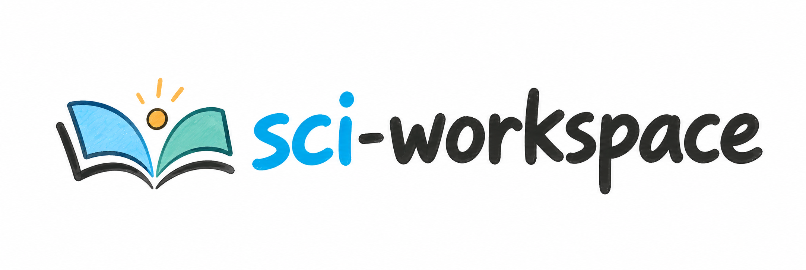

<p align="center">
  
</p>

[](./LICENSE)


# sci-workspace

一个轻量的 SCI 论文工作区 skill，以完成并持续修订整篇 manuscript 为目标。告诉 Codex 等 Agent 你要开始写一篇论文，它会搭好目录，让文献、整稿、章节、数据和结果各有位置。

默认创建五个顶层目录和六个常用章节，已有文件保留，材料子目录按需增加。

## 安装

告诉支持 Agent Skills 的工具：

```text
请从这个仓库安装 sci-workspace skill：
https://github.com/spw779/sci-workspace
技能入口是仓库根目录的 SKILL.md。
```

安装时保留本仓库的相对目录结构。已安装旧版时，让 Agent 更新到最新版本。每篇论文放在单独的项目文件夹中。

## 使用

在论文文件夹中告诉 Agent：

```text
我要开始写这篇 SCI 论文。
请用 $sci-workspace 初始化当前论文工作区，保留已有文件。
```

默认结构：

| 目录 | 放什么 |
| --- | --- |
| `01_reference/` | 文献 PDF 和阅读材料 |
| `02_manuscript/` | 整篇论文的 Word 稿件，按 `manuscript_v1.docx`、`manuscript_v2.docx` 等保存 |
| `03_chapter/` | 分章节稿件，默认包含下列六章 |
| `04_data/` | 实验数据、原始照片、记录及数据说明 |
| `05_results/` | 分析输出、结果表和稿件图片 |

`03_chapter/` 默认包含 **Abstract、Introduction、Methods、Results、Discussion、Conclusions**。Methods 和 Results 在第一次初始化时就会创建。Conclusions 是否作为独立章节进入最终整稿，按目标期刊要求处理。

同时生成简短的 `WORKSPACE_GUIDE.md` 和 `AGENTS.md`，供后续任务了解项目约定。初始化只创建目录和说明，实际稿件在写作时生成。

**`03_chapter/Results` 放结果章节正文；`05_results` 放支撑正文的结果文件。**

需要细分数据和结果时再说：

```text
请为当前论文工作区增加常用的数据和结果子目录。
```

这会增加 `04_data/{raw,processed,metadata}` 和 `05_results/{statistics,tables,figures}`。其他章节、实验批次、补充材料或分析代码目录按实际任务添加。

## 整稿与章节版本

`02_manuscript/` 在初始化时就会创建，用来保存整篇论文，与各章节一样保留 Word 版本：

| 稿件 | 文件夹 | 文件名示例 |
| --- | --- | --- |
| 整篇 manuscript | `02_manuscript/` | `manuscript_v1.docx`、`manuscript_v2.docx` |
| Methods 章节 | `03_chapter/Methods/` | `Methods_v1.docx`、`Methods_v2.docx` |
| Results 章节 | `03_chapter/Results/` | `Results_v1.docx`、`Results_v2.docx` |

其他章节使用相同的 `<Section>_vN.docx` 规则。首稿从 `v1` 开始；交付新修订稿时，按该类稿件现有最大数字版本号加一另存，保留旧版。整稿与各章节各自编号，例如 `manuscript_v2.docx` 可以使用 `Methods_v4.docx` 的内容。

已有的 `manuscript.docx` 或其他命名文件保留原样；后续新稿按上述约定保存，用户另有命名或格式要求时遵循用户要求。实际写作或合稿时生成 Word 文件。

## 已有项目

重复初始化只补齐缺失目录和说明，包括缺失的默认章节。已有稿件、数据、手写指南及自定义章节继续保留。原始输入保留，处理后的文件另存。

已有项目使用不同目录名称时，先让 Agent 读取项目指南、登记实际位置，再补需要的目录。大型数据或独立分析项目可在指南中记录路径。

正文写作、文献处理和数据分析由对应 skills 完成，并沿用本项目的目录约定。

## 直接运行

脚本使用 Python 3.10+ 标准库。在仓库根目录运行：

```bash
python scripts/workspace.py init --root ../PaperA
python scripts/workspace.py init --root ../PaperA --with-subdirs
python scripts/workspace.py init --root ../PaperA --sections Acknowledgments
python scripts/workspace.py init --root ../PaperA --dry-run
python scripts/workspace.py status --root ../PaperA
```

- `--project-name`：设置新指南的项目名，省略时使用文件夹名。
- `--sections`：在默认六章基础上增加指定章节，已有章节保留。
- `--with-subdirs`：增加六个常用数据和结果子目录。
- `--dry-run`：仅预览，不创建文件或目录。
- `status`：只读检查五个目录、六章和两份说明，列出已有自定义章；材料子目录未创建属于正常情况。

脚本输出 JSON。路径类型冲突会在初始化写入前报告，已有说明不会被模板覆盖。

## 开发检查

```bash
python -m unittest discover -s tests -v
```

## 许可证

本项目采用 [MIT License](./LICENSE)。
