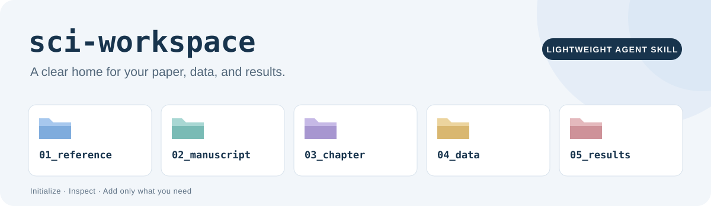

[](./LICENSE)


# sci-workspace

为 SCI 论文项目搭建清楚、稳定、可以重复初始化的目录结构，让文献、稿件、数据和结果各有位置。

A lightweight Agent Skill for setting up and inspecting SCI manuscript workspaces.

`sci-workspace` 负责目录搭建、补齐和结构检查。正文写作、文献处理、统计分析和审稿由相应 skills 完成，沿用同一份项目指南查找输入、保存输出。

## 一分钟安装与使用

### 安装 skill

在支持技能安装的 Agent 中发送：

```text
请安装这个仓库中的 sci-workspace/ skill：
https://github.com/spw779/sci-workspace
```

在 Codex 中，也可以请求 `$skill-installer` 从上述 GitHub 仓库安装 `sci-workspace/`。安装入口是包内的 [`sci-workspace/SKILL.md`](./sci-workspace/SKILL.md)，应连同该目录下的脚本、模板和说明一起安装。

Codex 可将技能放在用户目录 `~/.agents/skills/`，或项目目录 `.agents/skills/`；具体操作见 [官方技能说明](https://learn.chatgpt.com/docs/build-skills)。使用其他 Agent 时，遵循其支持的技能安装方式。

### 初始化论文项目

打开单独的论文文件夹 `PaperA`，告诉 Agent：

```text
请用 $sci-workspace 初始化当前 PaperA 论文项目。
保留已有文件，只补齐缺失的目录和说明。
```

需要章节和材料分类时可以继续说：

```text
请用 $sci-workspace 为 PaperA 增加 Methods、Results 章节目录，
以及原始数据、处理后数据、数据说明、统计输出、结果表和图片子目录。
```

技能安装目录用于保存工具；论文工作区建在你选定的 `PaperA` 目录中。

## 默认生成什么

默认创建五个顶层目录：

| 目录 | 放什么 |
| --- | --- |
| `01_reference/` | 文献 PDF、阅读材料和已有引用库导出 |
| `02_manuscript/` | 完整稿件 |
| `03_chapter/` | 分章节稿件，章节子目录按需创建 |
| `04_data/` | 实验数据、原始照片、实验记录和数据说明 |
| `05_results/` | 分析输出、结果表、稿件图及可编辑来源 |

同时创建两份简短说明：

| 文件 | 用途 |
| --- | --- |
| `WORKSPACE_GUIDE.md` | 本项目的范围、目录用途、文件约定和外部材料位置 |
| `AGENTS.md` | 提醒后续 Agent 先读取项目指南，并保留已有材料 |

章节目录默认不创建。初始化也不会生成空白 DOCX、示例实验数据或虚构研究结果；已有文件继续保留。

## 可选章节与材料子目录

按实际需要增加以下目录：

| 父目录 | 可选子目录 |
| --- | --- |
| `03_chapter/` | `Abstract`、`Introduction`、`Methods`、`Results`、`Discussion`、`Conclusions`，也支持其他实际需要的章节名 |
| `04_data/` | `raw`：原始输入；`processed`：处理后数据；`metadata`：样本、分组、单位和方法等说明 |
| `05_results/` | `statistics`：统计输出；`tables`：结果表；`figures`：稿件图 |

`--sections` 只增加指定章节；`--with-subdirs` 一次增加上述六个数据和结果子目录。省略选项不会删除已经存在的目录。

**`03_chapter/Results` 存结果章节正文；`05_results` 存支撑正文的结果文件。** 独立 Conclusions 是否进入最终整稿，由目标期刊和写作任务决定。

实验批次、分析脚本、补充材料和归档目录在用到时再建。大型数据或已有分析项目可以在 Guide 中登记真实路径及版本，无须为了初始化搬入全部材料。

## 已有项目与重复运行

- **标准目录补缺：** 再次初始化只创建缺失项，保留已有目录、稿件、数据和说明文件。
- **手写指南保留：** 已有 `WORKSPACE_GUIDE.md` 和 `AGENTS.md` 不会被模板覆盖；需要记录新约定时，另行基于原文更新。
- **自定义布局复用：** 若旧项目已用其他名称存放材料，先让 Agent 检查用途，在 Guide 中登记对应路径，再补需要的目录。
- **路径冲突先处理：** 脚本先检查目标路径和模板。发现类型冲突、无效链接或指向项目外的链接时报告问题；预检失败不会开始创建。
- **原始材料保留：** 初始化不搬移、重命名、清洗或重算研究文件。后续处理遵循原始输入保留、处理结果另存的约定。

脚本使用固定的五目录布局，不会自动推断旧目录的用途。对于已有自定义结构的项目，先由 Agent 适配，避免生成两套平行目录。

## 直接运行

脚本使用 Python 3.10+ 标准库，无需安装额外 Python 包。也可以不安装 skill，直接在仓库根目录运行：

```bash
git clone https://github.com/spw779/sci-workspace.git
cd sci-workspace
python sci-workspace/scripts/workspace.py init --root ../PaperA
```

增加指定章节与材料子目录：

```bash
python sci-workspace/scripts/workspace.py init --root ../PaperA --sections Methods Results --with-subdirs
```

预览初始化计划，或只读检查已有工作区：

```bash
python sci-workspace/scripts/workspace.py init --root ../PaperA --dry-run
python sci-workspace/scripts/workspace.py status --root ../PaperA
```

| 参数或命令 | 行为 |
| --- | --- |
| `init --root PATH` | 创建或补齐目标工作区，目标根目录可以尚不存在 |
| `--project-name PaperA` | 设置新 Guide 的项目名；省略时使用目标文件夹名 |
| `--sections Methods Results` | 仅添加列出的章节目录 |
| `--with-subdirs` | 添加六个常用数据、结果子目录 |
| `--dry-run` | 仅预览，完全不创建文件或目录 |
| `status --root PATH` | 检查已存在工作区的标准结构，列出已有章节和常用材料子目录 |

脚本以 JSON 报告结果：初始化列出 `created`、`preserved`，预览列出 `would_create`；检查报告路径是否存在及类型冲突。可选目录尚未创建不算缺陷。

`status` 检查文件和目录是否存在，不读取稿件或数据内容；自定义布局应结合 Guide 中记录的真实路径理解检查结果。

## 开发验证

在仓库根目录运行：

```bash
python -m unittest discover -s sci-workspace/tests -v
```

验证重点是默认结构、可选目录、重复运行保留内容、零写入预览和路径冲突处理。测试结果以实际运行输出为准。

## 仓库文件

| 路径 | 用途 |
| --- | --- |
| [`README.md`](./README.md) | 安装、使用和仓库说明 |
| [`LICENSE`](./LICENSE) | MIT 许可 |
| [`assets/banner.svg`](./assets/banner.svg) | 首页横幅 |
| [`sci-workspace/SKILL.md`](./sci-workspace/SKILL.md) | Agent 的触发条件与工作流程 |
| [`sci-workspace/agents/openai.yaml`](./sci-workspace/agents/openai.yaml) | Codex 展示信息与默认提示 |
| [`sci-workspace/scripts/workspace.py`](./sci-workspace/scripts/workspace.py) | 初始化和只读检查脚本 |
| [`sci-workspace/assets/`](./sci-workspace/assets/) | Guide 与 AGENTS 模板 |
| [`sci-workspace/references/workspace-workflow.md`](./sci-workspace/references/workspace-workflow.md) | 旧项目适配和交付约定 |
| [`sci-workspace/tests/`](./sci-workspace/tests/) | 脚手架行为验证 |

## 参考与许可

本项目自行实现轻量目录脚手架，并参考以下项目的组织思路：

- [EasyMeta](https://github.com/Rimagination/easymeta)：中文首页展示与技能包组织。
- [Open Science Skills](https://github.com/scdenney/open-science-skills)：新建工作区与现有项目检查的职责划分。
- [Cookiecutter Data Science](https://github.com/drivendataorg/cookiecutter-data-science)：原始数据与处理后数据分层。

原创代码与文档采用 [MIT License](./LICENSE) 发布。
